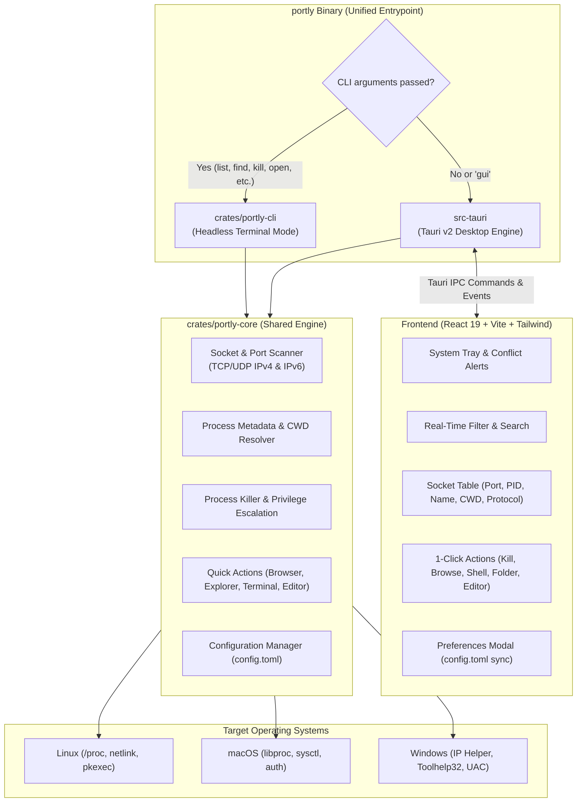

# Portly: High-Level Architecture & Technical Specification

## 1. Executive Summary

**Portly** is a high-performance, cross-platform port and process manager designed for Linux, macOS, and Windows. It provides developers and system administrators with immediate visibility into active network sockets, their associated processes, and their working directories (CWD), along with single-click actions to terminate offending processes, launch listening services in a browser, or open terminals and code editors directly inside their project roots.

Portly is distributed as a **unified dual-mode binary**:
- **CLI Mode**: Running with subcommands or flags (e.g., `portly list`, `portly find 3000`, `portly kill 8080`, `portly open 5173`, `portly config`) executes headlessly in the terminal with sub-millisecond execution and JSON streaming options.
- **Desktop GUI Mode**: Running without subcommands launches an ultra-responsive, lightweight desktop application powered by **Tauri v2** and **React 19**, complete with a native system tray icon, real-time background socket monitoring, 1-click port pinning, and port collision alerts.

---

## 2. Technology Stack & Rationale

| Layer | Technology | Rationale |
| :--- | :--- | :--- |
| **Core Engine** | Rust 2021 (`crates/portly-core`) | Native performance, memory safety, zero-cost cross-platform abstractions. |
| **Socket & Process Discovery** | `netstat2`, `sysinfo`, OS-specific APIs (`procfs` on Linux, `libproc` on macOS, Win32 IP Helper on Windows) | Fast, non-blocking asynchronous socket inspection without shell overhead. |
| **Privilege Escalation** | `pkexec` (Linux), `osascript` (macOS), UAC `runas` (Windows) | Safe, interactive elevation prompts only when killing or inspecting root/admin processes. |
| **CLI Layer** | `clap` v4 (derive), `comfy-table`, `colored` (`crates/portly-cli`) | High ergonomics, bash/zsh/fish completions, JSON output for automation. |
| **Desktop Shell** | **Tauri v2** (`src-tauri`) | Minimal memory footprint (~35MB RAM vs 300MB+ in Electron), native system tray, cross-platform window management. |
| **Frontend UI** | React 19 + TypeScript + Vite + Tailwind CSS + Lucide Icons | Fast virtualized socket table, instant search/filtering, clean modern aesthetics. |
| **Configuration** | `toml` + `dirs` | Native persistent configuration in standard user config directory (`~/.config/portly/config.toml`). |
| **Package Manager** | `pnpm` (Frontend) + `cargo` (Rust workspace) | Strict dependency isolation, fast reproducible builds. |

---

## 3. High-Level Architecture

```text
               +----------------------------------+
               |     Unified Entrypoint (portly)   |
               +-----------------+----------------+
                                 |
           +---------------------+---------------------+
           |                                           |
+----------v-----------+                    +----------v-----------+
|     portly-cli       |                    |       src-tauri      |
| (clap v4 headless)   |                    | (Tauri v2 Desktop)   |
+----------+-----------+                    +----------+-----------+
           |                                           |
           +---------------------+---------------------+
                                 |
                    +------------v------------+
                    |       portly-core       |
                    | (Platform Agnostic)     |
                    +------------+------------+
                                 |
        +------------------------+------------------------+
        |                        |                        |
+-------v-------+        +-------v-------+        +-------v-------+
|  Linux Engine |        | macOS Engine  |        | Windows Engine|
| (/proc, pkexec|        | (libproc, auth|        | (IP Helper,   |
|   netstat2)   |        |   netstat2)   |        |   Win32 UAC)  |
+---------------+        +---------------+        +---------------+
```



---

## 4. AI-First Architecture & Contributor Governance

Because Portly is maintained with AI agent pairing, the repository embeds strict engineering standards, machine-readable specifications, agent instructions, and skills:

```text
portly/
├── AGENTS.md                     # Universal agent operating manual (L8 discipline, workflow, zero-mock rule)
├── CLAUDE.md                     # Claude Code / CLI agent instructions & fast command cheatsheet
├── .cursor/
│   └── rules/                    # Cursor IDE agent rules (rust.mdc, tauri.mdc, react.mdc)
├── .gemini/
│   ├── config.yaml               # Antigravity CLI project configuration
│   └── skills/                   # Local Antigravity skills for portly development
├── docs/                         # Architectural source of truth
│   ├── ARCHITECTURE.md           # This document (High-level architecture & technical spec)
│   ├── ROADMAP.md                # Phased development roadmap & milestone tracking
│   ├── PRIVILEGE-ESCALATION.md   # Security spec for pkexec / UAC execution
│   ├── IPC-CONTRACT.md           # Strongly-typed Tauri command & event schema
│   └── OS-SUPPORT.md             # Linux, macOS, and Windows matrix & caveats
└── tasks/                        # Granular task specs with verification criteria
    ├── 01-scaffold-workspace.md
    ├── 02-core-socket-engine.md
    ├── 03-core-process-cwd.md
    ├── 04-core-process-killer.md
    ├── 05-cli-implementation.md
    ├── 06-tauri-ipc-tray.md
    ├── 07-react-ui-components.md
    └── 08-packaging-ci.md
```

### Core Operating Rules
1. **Production-Ready & Zero Mocks**: Never write toy or mock data implementations. Every scan must query real OS sockets and process trees.
2. **Elevated Privilege Safety**: Never execute destructive operations silently. Privilege escalation (`pkexec` on Linux, UAC on Windows, authorization on macOS) must be requested explicitly and safely.
3. **No Em-Dashes**: Maintain clean prose and commit messages using hyphens (`-`) or colons (`:`).
4. **End-to-End Verification**: Each task must be verified using real integration tests or live CLI/GUI runs before marking complete.

---

## 5. Repository Layout & Crate Responsibilities

```text
portly/
├── crates/
│   ├── portly-core/              # Core library: cross-platform scanning & actions
│   │   ├── Cargo.toml
│   │   └── src/
│   │       ├── lib.rs
│   │       ├── socket.rs         # Port & socket abstraction, conflict detector
│   │       ├── process.rs        # PID, process name, executable path, CWD
│   │       ├── killer.rs         # Graceful & forced termination + elevation
│   │       ├── actions.rs        # Open in browser, file manager, terminal, editor
│   │       ├── config.rs         # Persistent config manager (~/.config/portly/config.toml)
│   │       └── os/               # OS-specific implementations
│   │           ├── linux.rs      # /proc-based inspection, system ports, pkexec
│   │           ├── macos.rs      # libproc inspection, lsof CWD fallback, osascript
│   │           └── windows.rs    # Win32 IP Helper, sysinfo, UAC runas
│   └── portly-cli/               # CLI crate
│       ├── Cargo.toml
│       └── src/
│           ├── main.rs           # Entrypoint binary
│           └── lib.rs            # CLI commands, table output, streaming JSON
├── src-tauri/                    # Tauri v2 desktop application
│   ├── Cargo.toml
│   ├── tauri.conf.json           # Tauri v2 configuration (offline asset bundling)
│   ├── icons/                    # App icon suite (32x32, 128x128, 256x256, .ico, .icns)
│   └── src/
│       ├── main.rs               # Unified entrypoint (CLI check vs Tauri init)
│       └── commands.rs           # Tauri IPC commands wrapping portly-core
└── ui/                           # React 19 Frontend
    ├── index.html
    ├── package.json
    ├── vite.config.ts
    ├── src/
    │   ├── App.tsx               # Main layout, search, keyboard shortcuts
    │   ├── types.ts              # TypeScript interfaces matching Rust models
    │   └── components/
    │       ├── PortTable.tsx     # Filterable socket table with port pinning stars
    │       ├── QuickActions.tsx  # 1-click Kill, Open Browser, Open CWD buttons
    │       ├── ConflictBanner.tsx# Port collision notification indicator
    │       ├── SearchBar.tsx     # Fast instant filter by port, PID, or name
    │       └── SettingsModal.tsx # In-app preferences modal
```

---

## 6. CLI Interface Design

The command-line interface provides instant answers without opening a window:

```bash
# List all active listening ports in a formatted table
portly list

# List in JSON format (ideal for scripts and pipelines)
portly list --json

# Filter or search by port number or process name
portly find 3000
portly find node

# Print the working directory of the process holding port 3000
portly cwd 3000

# Terminate process on a port (graceful SIGTERM, fallback to SIGKILL)
portly kill 3000
portly kill 3000 --force --escalate

# Open the listening service in the default web browser (auto-detects if port omitted)
portly open
portly open 5173
portly open 5173 --https

# Check for dual-stack or wildcard port collisions
portly conflicts

# Live terminal monitor mode (auto-refreshes every 2 seconds)
portly watch --interval 2

# View or update persistent configuration
portly config
portly config set-editor cursor
portly config set-terminal ghostty
portly config pin 3000

# Generate shell completions
portly completions zsh > ~/.zsh/completion/_portly
```

---

## 7. Desktop Quick Actions & User Experience

1. **One-Click Kill**:
   - Sends a graceful termination signal (`SIGTERM` / `WM_CLOSE`).
   - If the process doesn't exit within 1.5s, prompts or automatically escalates to `SIGKILL` (`kill -9` / `TerminateProcess`).
   - If the process belongs to another user (e.g. root), invokes native privilege escalation (`pkexec` on Linux, authorization on macOS, UAC on Windows).
2. **One-Click Open in Browser**:
   - Detects IPv4 / IPv6 bind address (`0.0.0.0` or `127.0.0.1` -> `http://localhost:<port>`).
   - Uses prioritized desktop handoff (`omarchy-launch-browser`, `xdg-open`, `gio`, `zen-browser`, `google-chrome-stable`, `firefox`) to ensure the window is focused.
3. **One-Click Open Working Directory (CWD)**:
   - **Open in File Explorer**: Launches default file manager with the directory selected.
   - **Open in Editor**: Detects preferred editor from `config.toml` (`cursor`, `code`, `zed`, `subl`) and opens the project root.
   - **Open in Terminal**: Spawns preferred terminal (`ghostty`, `kitty`, `alacritty`, `wt.exe`) navigated directly to the process CWD.
4. **1-Click Port Pinning**:
   - Clicking the star icon pins frequently used development ports to the top of the table and persists to `config.toml`.

---

## 8. Packaging & Distribution Model

- **Linux**:
  - Arch Linux / Omarchy `PKGBUILD` and desktop launcher entry (`packaging/portly.desktop`)
  - AppImage (standalone bundle)
  - Debian package (`.deb`) and RedHat package (`.rpm`)
- **macOS**:
  - `.dmg` disk image and `.app` bundle
  - Universal binary targeting both Apple Silicon (`aarch64-apple-darwin`) and Intel (`x86_64-apple-darwin`)
- **Windows**:
  - NSIS installer (`.exe`) and WiX MSI installer (`.msi`)
- **Package Managers**:
  - Arch User Repository (`aur/portly-bin`)
  - Homebrew tap (`brew install portly`)
  - Winget and Scoop for Windows
  - Crates.io publication (`cargo install portly-cli`)
